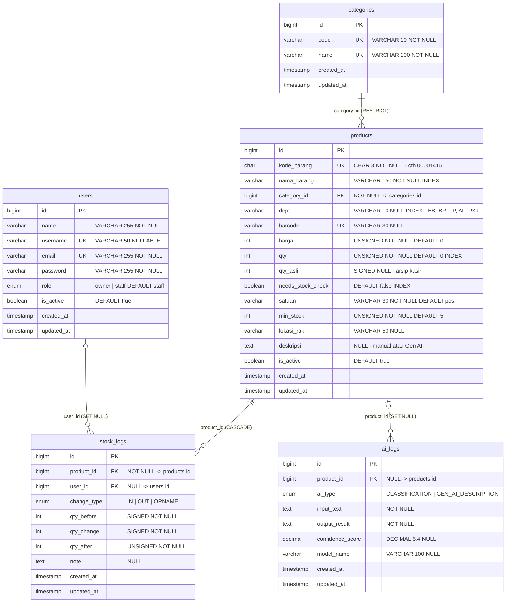

# Backend-IstanaJaya — Dokumentasi & Spesifikasi Database

Backend REST API untuk proyek Capstone **Asah 2026 (Tim A26-CS182 — DataForge)**:  
**Digitalisasi Pencatatan dan Pemantauan Stok Barang pada Toko Istana Jaya Elektronik**.

Dokumen ini menjadi acuan utama (*single source of truth*) untuk struktur database, relasi antar tabel, aturan bisnis stok, pemetaan dataset dari tim Data Science, serta panduan migrasi awal di **Laravel 13 + MySQL**.

---

## 1. Tech Stack & Lingkungan Database

- **Framework:** Laravel 13 (API-Only / Decoupled, konvensi endpoint `/api/v1/...`)
- **Database:** MariaDB / MySQL (`utf8mb4` / `utf8mb4_unicode_ci`)
- **Integrasi Eksternal:** FastAPI AI Service (Klasifikasi Kategori ML & Deskripsi Generative AI)
- **Sumber Dataset Awal:** `inventaris_clean` dari tim Data Science (`dataset_stok_istana_jaya_final.xlsx` — 158 produk unik, 7 kategori)

### Konfigurasi `.env` (MariaDB Lokal macOS)
```env
APP_NAME="Istana Jaya Inventory API"

DB_CONNECTION=mariadb
DB_HOST=127.0.0.1
DB_PORT=3306
DB_DATABASE=istana_jaya_db
DB_USERNAME=root
DB_PASSWORD=

AI_SERVICE_URL=[http://127.0.0.1:8001](http://127.0.0.1:8001)
AI_SERVICE_TIMEOUT=15
```

> **Catatan:** Gunakan `127.0.0.1` (bukan `localhost`) untuk menghindari error socket di macOS. Jika menggunakan Oracle MySQL 8+, ganti `DB_CONNECTION=mysql`.

---

## 2. Batasan Cakupan & Privasi Data (WAJIB DIPATUHI)

Sesuai kesepakatan wawancara dengan PIC UMKM (Bapak M. Nauval Rianda), skema database **DILARANG** menyimpan:
- Harga beli / harga modal barang dan nominal keuntungan.
- Data transaksi penjualan / kasir, retur, garansi, atau laporan keuangan.
- Data pribadi pelanggan maupun data pemasok (*supplier*).

Database hanya berfokus pada **katalog inventaris, pencarian stok instan, pembaruan stok, riwayat pergerakan stok (`IN`/`OUT`/`OPNAME`), dan log layanan AI**.

---

## 3. Klasifikasi Tabel & ERD

Database terdiri dari **5 tabel utama** (3 Tabel Master dan 2 Tabel Transaksi/Log):

| Jenis Tabel | Nama Tabel | Status | Peran Utama |
| :--- | :--- | :--- | :--- |
| **Master** | `categories` | Wajib (MVP) | Master 7 kode & nama kategori barang hasil finalisasi tim DS. |
| **Master** | `products` | Wajib (MVP) | Data induk katalog stok barang (mapping dari `inventaris_clean`). |
| **Master** | `users` | Opsional | Akun `owner` & `staff` (memperluas tabel `users` bawaan Laravel). |
| **Transaksi / Log** | `stock_logs` | Wajib (MVP) | Audit trail setiap perubahan stok (`IN`, `OUT`, `OPNAME`). |
| **Transaksi / Log** | `ai_logs` | Pendukung (AI) | Riwayat request/response klasifikasi ML & deskripsi Generative AI. |

### Entity Relationship Diagram (Mermaid)



---

## 4. Spesifikasi Detail Migrasi (Laravel Blueprint — MariaDB/MySQL)

> **Penting untuk Migrasi:**
> 1. Laravel 13 sudah memiliki migrasi bawaan `0001_01_01_000000_create_users_table.php`. **Jangan membuat ulang tabel `users`**; tambahkan kolom `username`, `role`, dan `is_active` melalui migrasi `ALTER TABLE` terpisah.
> 2. Semua Primary Key menggunakan `$table->id()` (`BIGINT UNSIGNED AUTO_INCREMENT`), sehingga Foreign Key wajib menggunakan `$table->foreignId(...)`.
> 3. Urutan pembuatan migrasi wajib: `categories` → `products` → `stock_logs` → `ai_logs` (agar Foreign Key tidak gagal saat `php artisan migrate`).

### 4.1. Tabel `categories`
| Kolom | Laravel Blueprint | Constraint & Keterangan |
| :--- | :--- | :--- |
| `id` | `$table->id()` | Primary Key |
| `code` | `$table->string('code', 10)->unique()` | Kode kategori: `BL`, `CA`, `KS`, `KA`, `MT`, `PP`, `LM` |
| `name` | `$table->string('name', 100)->unique()` | Nama tampilan UI |
| `timestamps` | `$table->timestamps()` | `created_at`, `updated_at` |

### 4.2. Alter Tabel `users` (Opsional / Pengembangan Lanjutan)
Tambahkan kolom ke tabel `users` bawaan Laravel lewat migrasi `add_role_fields_to_users_table`:
| Kolom | Laravel Blueprint | Constraint & Keterangan |
| :--- | :--- | :--- |
| `username` | `$table->string('username', 50)->nullable()->unique()->after('name')` | Username login staf/pemilik |
| `role` | `$table->enum('role', ['owner', 'staff'])->default('staff')->after('password')` | Hak akses |
| `is_active` | `$table->boolean('is_active')->default(true)->after('role')` | Status aktif akun |

### 4.3. Tabel `products`
| Kolom | Laravel Blueprint | Constraint & Keterangan |
| :--- | :--- | :--- |
| `id` | `$table->id()` | Primary Key |
| `kode_barang` | `$table->char('kode_barang', 8)->unique()` | Teks 8 digit dari `inventaris_clean.kode` (cth: `'00001415'`) |
| `nama_barang` | `$table->string('nama_barang', 150)->index()` | Nama barang (di-index untuk pencarian cepat) |
| `category_id` | `$table->foreignId('category_id')->constrained('categories')->cascadeOnUpdate()->restrictOnDelete()` | Relasi wajib ke `categories.id` |
| `dept` | `$table->string('dept', 10)->nullable()->index()` | Kode departemen kasir (`BB`, `BR`, `LP`, `AL`, `PKJ`); 2 baris `NULL` |
| `barcode` | `$table->string('barcode', 30)->nullable()->unique()` | Barcode kasir/EAN-13; MariaDB mengizinkan banyak `NULL` pada kolom `UNIQUE` |
| `harga` | `$table->unsignedInteger('harga')->default(0)` | Harga jual (Rp) bilangan bulat tanpa titik ribuan |
| `qty` | `$table->unsignedInteger('qty')->default(0)->index()` | Stok aktif di aplikasi (tidak boleh negatif); awal diisi dari `qty_bersih` |
| `qty_asli` | `$table->integer('qty_asli')->nullable()` | Signed integer; arsip stok asli kasir (boleh negatif atau `NULL`) |
| `needs_stock_check` | `$table->boolean('needs_stock_check')->default(false)->index()` | `true` jika `qty_asli < 0` untuk menampilkan badge **"Perlu Dicek"** di UI |
| `satuan` | `$table->string('satuan', 30)->default('pcs')` | Satuan barang (`pcs`, `kaleng`, `batang`, `buah`, `meter`) |
| `min_stock` | `$table->unsignedInteger('min_stock')->default(5)` | Ambang batas peringatan stok menipis (`qty <= min_stock`) |
| `lokasi_rak` | `$table->string('lokasi_rak', 50)->nullable()` | Lokasi fisik rak/gudang di toko |
| `deskripsi` | `$table->text('deskripsi')->nullable()` | Keterangan manual atau hasil Generative AI |
| `is_active` | `$table->boolean('is_active')->default(true)` | Soft delete barang yang tidak lagi dijual |
| `timestamps` | `$table->timestamps()` | `created_at`, `updated_at` |

### 4.4. Tabel `stock_logs`
| Kolom | Laravel Blueprint | Constraint & Keterangan |
| :--- | :--- | :--- |
| `id` | `$table->id()` | Primary Key |
| `product_id` | `$table->foreignId('product_id')->constrained('products')->cascadeOnDelete()` | Relasi ke `products.id` |
| `user_id` | `$table->foreignId('user_id')->nullable()->constrained('users')->nullOnDelete()` | Nullable agar MVP berjalan tanpa fitur login |
| `change_type` | `$table->enum('change_type', ['IN', 'OUT', 'OPNAME'])` | Jenis transaksi stok |
| `qty_before` | `$table->integer('qty_before')` | Jumlah stok sebelum perubahan |
| `qty_change` | `$table->integer('qty_change')` | Selisih perubahan (bisa positif/negatif) |
| `qty_after` | `$table->unsignedInteger('qty_after')` | Jumlah stok setelah perubahan (wajib `>= 0`) |
| `note` | `$table->text('note')->nullable()` | Catatan barang masuk/keluar/opname fisik |
| `timestamps` | `$table->timestamps()` | Composite index pada `['product_id', 'created_at']` |

### 4.5. Tabel `ai_logs`
| Kolom | Laravel Blueprint | Constraint & Keterangan |
| :--- | :--- | :--- |
| `id` | `$table->id()` | Primary Key |
| `product_id` | `$table->foreignId('product_id')->nullable()->constrained('products')->nullOnDelete()` | Relasi opsional (bisa `NULL` saat prediksi sebelum produk disimpan) |
| `ai_type` | `$table->enum('ai_type', ['CLASSIFICATION', 'GEN_AI_DESCRIPTION'])` | Jenis layanan AI yang dipanggil |
| `input_text` | `$table->text('input_text')` | Nama barang atau prompt input |
| `output_result` | `$table->text('output_result')` | Prediksi kategori atau teks deskripsi hasil AI |
| `confidence_score` | `$table->decimal('confidence_score', 5, 4)->nullable()` | Skor kepercayaan model ML (misal `0.9450`) |
| `model_name` | `$table->string('model_name', 100)->nullable()` | Nama model ML atau API Gen AI yang digunakan |
| `timestamps` | `$table->timestamps()` | `created_at`, `updated_at` |

---

## 5. Relasi Eloquent & Aturan Bisnis Inti

### Relasi Model
- `Category`: `hasMany(Product::class)`
- `Product`: `belongsTo(Category::class)`, `hasMany(StockLog::class)`, `hasMany(AiLog::class)`
- `StockLog`: `belongsTo(Product::class)`, `belongsTo(User::class)`
- `AiLog`: `belongsTo(Product::class)`
- `User`: `hasMany(StockLog::class)`

### Aturan Bisnis Stok
1. Setiap perubahan stok wajib dibungkus `DB::transaction()` dengan `lockForUpdate()` pada baris `products`.
2. **`IN`**: `qty_after = qty_before + amount`, `qty_change = +amount`.
3. **`OUT`**: Tolak dengan HTTP `422` jika `amount > qty_before` (stok tidak boleh menjadi negatif).
4. **`OPNAME`**: `qty_after = amount`, `qty_change = qty_after - qty_before`, dan otomatis set `products.needs_stock_check = false` karena stok fisik sudah diverifikasi.
5. **Status Stok (Computed di API Resource):**
   - `HABIS` jika `qty == 0`
   - `MENIPIS` jika `qty > 0 && qty <= min_stock`
   - `AMAN` jika `qty > min_stock`

---

## 6. Spesifikasi Seeding Data Awal (`CategorySeeder` & `ProductSeeder`)

### 6.1. Master 7 Kategori (`CategorySeeder`)
> Kode `ATG` dari kasir lama sudah digabung ke `MT` (**Meteran**) oleh tim DS. Kategori `LM` (**Lem**, 1 baris) tetap disimpan di database inventaris meskipun dikeluarkan dari dataset latih model AI (`dataset_klasifikasi`).

| `code` | `name` |
| :--- | :--- |
| `BL` | Bola Lampu |
| `CA` | Cat |
| `KS` | Kuas |
| `KA` | Kran Air |
| `MT` | Meteran |
| `PP` | Pipa |
| `LM` | Lem |

### 6.2. Aturan Pemetaan `inventaris_clean.csv` → `products` (`ProductSeeder`)
Letakkan file CSV bersih dari tim DS di `database/data/inventaris_clean.csv`, lalu petakan kolomnya sebagai berikut:

| Kolom CSV (`inventaris_clean`) | Kolom Tabel `products` | Aturan Transformasi |
| :--- | :--- | :--- |
| `kode` | `kode_barang` | Wajib disimpan sebagai string 8 digit (`str_pad(..., 8, '0', STR_PAD_LEFT)`). |
| `nama_barang` | `nama_barang` | Trim spasi berlebih; pertahankan tanda kutip inci (`"`) dengan parser CSV standar (`fgetcsv`). |
| `kategori` | `category_id` | Cocokkan dengan `categories.name` untuk mengambil `id`. |
| `dept` | `dept` | Kosong (`""`) dikonversi menjadi `null`. |
| `barcode` | `barcode` | Simpan sebagai string; kosong (`""`) dikonversi menjadi `null`. |
| `harga` | `harga` | Integer non-negatif. |
| `qty_bersih` | `qty` | Integer non-negatif (stok awal tampil di aplikasi). |
| `qty_asli` | `qty_asli` | Signed integer; kosong (`""`) dikonversi menjadi `null`. |
| *(diturunkan dari `qty_asli`)* | `needs_stock_check` | Set `true` jika `qty_asli !== null && qty_asli < 0` (47 produk), selain itu `false`. |

---

## 7. Perintah Setup & Migrasi Awal

```bash
# 1. Buat database di MariaDB (jika belum dibuat)
# CREATE DATABASE istana_jaya_db CHARACTER SET utf8mb4 COLLATE utf8mb4_unicode_ci;

# 2. Bersihkan cache konfigurasi setelah edit .env
php artisan config:clear

# 3. Jalankan seluruh migrasi & seeder kategori (dan produk jika CSV tersedia)
php artisan migrate:fresh --seed

# 4. Verifikasi status tabel
php artisan migrate:status

# 5. Jalankan server API lokal
php artisan serve --host=127.0.0.1 --port=8000
```

---

## 8. Spesifikasi REST API (`/api/v1/...`)

- **Base URL Lokal:** `http://127.0.0.1:8000/api/v1`
- **Format:** JSON (`Accept: application/json`, `Content-Type: application/json`)
- **Mode MVP (Auth Opsional):** Seluruh endpoint inventaris, kategori, dashboard, stok, dan AI dapat diakses langsung tanpa login. Jika frontend mengirim header `Authorization: Bearer <token>`, `user_id` otomatis dicatat pada `stock_logs`.

### 8.1. Health & Dashboard
| Method | Endpoint | Keterangan |
| :--- | :--- | :--- |
| `GET` | `/api/v1/health` | Cek status kesehatan API |
| `GET` | `/api/v1/dashboard/summary` | Ringkasan total produk, total qty, distribusi status (`AMAN`/`MENIPIS`/`HABIS`), jumlah `needs_stock_check`, breakdown per kategori, dan 10 riwayat stok terbaru |

### 8.2. Master Kategori (`categories`)
| Method | Endpoint | Keterangan |
| :--- | :--- | :--- |
| `GET` | `/api/v1/categories` | Daftar seluruh kategori (+ `products_count` & `total_qty`). Mendukung `?search=` |
| `POST` | `/api/v1/categories` | Tambah kategori baru (`code`, `name`) |
| `GET` | `/api/v1/categories/{id}` | Detail kategori |
| `PUT/PATCH` | `/api/v1/categories/{id}` | Perbarui kategori |
| `DELETE` | `/api/v1/categories/{id}` | Hapus kategori (HTTP `409` jika masih dipakai produk) |

### 8.3. Katalog & Pencarian Produk (`products`)
| Method | Endpoint | Keterangan |
| :--- | :--- | :--- |
| `GET` | `/api/v1/products` | Daftar produk terpaginasi dengan pencarian & filter |
| `GET` | `/api/v1/products/lookup?code=...` | Pencarian instan exact match by `barcode` atau `kode_barang` (cocok untuk barcode scanner) |
| `POST` | `/api/v1/products` | Tambah produk baru (otomatis pad `kode_barang` 8 digit & catat `stock_logs` awal jika `qty > 0`) |
| `GET` | `/api/v1/products/{id}` | Detail produk beserta kategori, 20 `stock_logs` terbaru, dan 10 `ai_logs` terbaru |
| `PUT/PATCH` | `/api/v1/products/{id}` | Perbarui metadata produk (bukan perubahan stok) |
| `DELETE` | `/api/v1/products/{id}` | Soft-deactivate produk (`is_active = false`) |

**Query Parameters `GET /api/v1/products`:**
- `search` — cari di `nama_barang`, `kode_barang`, `barcode`, atau `lokasi_rak`
- `category_id` / `category_code` — filter berdasarkan ID atau kode kategori (`BL`, `CA`, `KS`, `KA`, `MT`, `PP`, `LM`)
- `dept` — filter departemen kasir (`BB`, `BR`, `LP`, `AL`, `PKJ`)
- `status` — filter status stok: `HABIS`, `MENIPIS`, atau `AMAN`
- `needs_stock_check` — `true` atau `false`
- `is_active` — `true` (default), `false`, atau `all`
- `sort_by` — `nama_barang` (default), `kode_barang`, `harga`, `qty`, `updated_at`, `created_at`
- `sort_dir` — `asc` (default) atau `desc`
- `per_page` — jumlah data per halaman (default `15`, maks `100`)

**Contoh Request `POST /api/v1/products`:**
```json
{
  "kode_barang": "00009901",
  "nama_barang": "BOLA LAMPU LED 12W PUTIH",
  "category_id": 1,
  "dept": "LP",
  "barcode": "8990100999001",
  "harga": 28000,
  "qty": 20,
  "satuan": "pcs",
  "min_stock": 5,
  "lokasi_rak": "RAK-A1",
  "deskripsi": "Lampu LED hemat energi 12W cahaya putih."
}
```

### 8.4. Pergerakan & Riwayat Stok (`stock_logs`)
| Method | Endpoint | Keterangan |
| :--- | :--- | :--- |
| `POST` | `/api/v1/products/{id}/stock` | Update stok atomik (`DB::transaction` + `lockForUpdate`) |
| `GET` | `/api/v1/products/{id}/stock-logs` | Riwayat pergerakan stok untuk 1 produk (paginated) |
| `GET` | `/api/v1/stock-logs` | Riwayat seluruh stok lintas produk. Filter: `?product_id=`, `?change_type=IN\|OUT\|OPNAME`, `?date_from=YYYY-MM-DD`, `?date_to=YYYY-MM-DD`, `?per_page=` |

**Contoh Request `POST /api/v1/products/{id}/stock`:**
```json
{
  "change_type": "IN",
  "amount": 10,
  "note": "Restok dari gudang belakang"
}
```
> - `IN`: `amount >= 1`, menambah stok.
> - `OUT`: `amount >= 1`, ditolak dengan **HTTP `422`** jika `amount > qty` saat ini.
> - `OPNAME`: `amount >= 0`, menyetel stok sesuai hitungan fisik dan otomatis mengubah `needs_stock_check = false`.

### 8.5. Integrasi Layanan AI (`ai_logs` — FastAPI)
| Method | Endpoint | Keterangan |
| :--- | :--- | :--- |
| `POST` | `/api/v1/ai/classify` | Klasifikasi kategori ML via `AI_SERVICE_URL/classify`, mencocokkan dengan `categories`, dan menyimpan log ke `ai_logs` |
| `POST` | `/api/v1/ai/generate-description` | Generate deskripsi via `AI_SERVICE_URL/generate-description`, simpan ke `ai_logs`, dan opsional langsung update `products.deskripsi` jika `apply_to_product: true` |
| `GET` | `/api/v1/ai/logs` | Riwayat log AI. Filter: `?product_id=`, `?ai_type=CLASSIFICATION\|GEN_AI_DESCRIPTION`, `?per_page=` |

**Contoh Request `POST /api/v1/ai/classify`:**
```json
{
  "nama_barang": "LAMPU LED PHILIPS 12W",
  "product_id": 1
}
```

**Contoh Request `POST /api/v1/ai/generate-description`:**
```json
{
  "nama_barang": "LAMPU LED PHILIPS 12W",
  "kategori": "Bola Lampu",
  "harga": 35000,
  "satuan": "pcs",
  "product_id": 1,
  "apply_to_product": true
}
```
> Jika service FastAPI sedang tidak aktif, API akan mengembalikan **HTTP `503 Service Unavailable`** dengan pesan JSON yang rapi.

### 8.6. Autentikasi Opsional (`users` — Sanctum Bearer Token)
| Method | Endpoint | Auth | Keterangan |
| :--- | :--- | :---: | :--- |
| `POST` | `/api/v1/auth/register` | Publik | Daftar akun (`name`, `username`, `email`, `password`, `password_confirmation`, `role`: `owner`\|`staff`) |
| `POST` | `/api/v1/auth/login` | Publik | Login dengan `login` (bisa `email` atau `username`) dan `password` → mengembalikan Bearer `token` |
| `GET` | `/api/v1/auth/me` | Bearer | Ambil profil user yang sedang login |
| `POST` | `/api/v1/auth/logout` | Bearer | Revoke token aktif |

---

## 9. Integrasi Frontend (React + Vite & CORS)

Konfigurasi CORS tersedia di `config/cors.php` dan secara default mengizinkan origin lokal Vite (`http://localhost:5173`, `http://127.0.0.1:5173`, `http://localhost:3000`, serta port localhost lainnya). Untuk production, set env:

```env
CORS_ALLOWED_ORIGINS=https://domain-frontend-anda.com
```

### Contoh Setup di React + Vite
Tambahkan di `.env` project frontend:
```env
VITE_API_URL=http://127.0.0.1:8000/api/v1
```

Contoh pemanggilan API dengan `fetch`:
```js
const API_URL = import.meta.env.VITE_API_URL;

export async function getProducts(params = {}) {
  const query = new URLSearchParams(params).toString();
  const res = await fetch(`${API_URL}/products?${query}`, {
    headers: { Accept: 'application/json' },
  });
  if (!res.ok) throw await res.json();
  return res.json();
}
```

---

## 10. Pengujian (Automated Testing)

Proyek dilengkapi feature test lengkap di `tests/Feature/InventoryApiTest.php` (menggunakan SQLite in-memory sehingga aman tanpa menyentuh database lokal):

```bash
# Jalankan seluruh test API
php artisan test

# Lihat seluruh daftar route API
php artisan route:list --path=api
```
